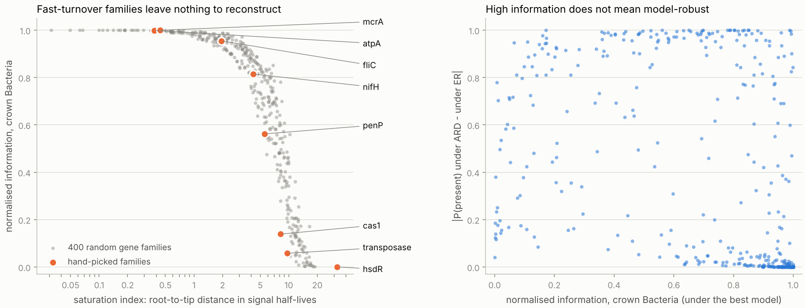

# mkhorizon

**How far back can a discrete trait be reconstructed on this tree?**

Ancestral-state reconstruction under the Mk model (`ape::ace`, `phytools::fitMk` /
`make.simmap`, `castor`) always returns a posterior for every node, including
nodes the tips can say nothing about. When a trait turns over quickly relative
to the depth of the tree, the posterior at a deep node is the root prior or an
artefact of the model class, and nothing in the standard output says so.

`mkhorizon` fits the model, reconstructs the ancestors, and then asks of every
node: *if this model were exactly true, how much could these tips tell me about
this ancestor?* It answers in bits, by simulation, and adds three checks that
catch the cases where that question is not enough.



*413 gene families on a 4,431-genome prokaryote phylogeny. Left: the information
the tips carry about the ancestor of Bacteria collapses once the root-to-tip
distance exceeds a few signal half-lives. Right: for many families that look
informative, the reconstructed state still depends on whether gain and loss
rates are allowed to differ. Details in [the worked example](#worked-example).*

## What it reports

For each internal node:

| Quantity | Meaning |
|---|---|
| `post_<state>`, `map_state` | marginal posterior under the fitted model (the usual output) |
| `information_bits` | mutual information between the node's state and the tip data |
| `normalised_information` | that information as a fraction of the node's prior entropy, 0 to 1 |
| `expected_accuracy`, `baseline_accuracy` | chance the maximum-posterior state is right, against guessing the prior mode |
| `height_half_lives` | mean distance to the node's tips, in signal half-lives |
| `ni_slow_rate`, `ni_fast_rate`, `verdict_robust` | the same information at both ends of the rate's 95% interval |
| `model_disagreement` | largest change in the posterior when only the model class (ER/SYM/ARD) changes |

For the trait as a whole:

- **Signal half-life** `ln 2 / ρ`, where `ρ` is the spectral gap of the rate
  matrix: the branch length over which a lineage forgets half of its starting
  state. The **saturation index** is the mean root-to-tip distance in half-lives.
- **Profile interval for the overall rate.** If it has no upper bound, the data
  cannot rule out infinitely fast evolution, i.e. tips that are independent of
  the tree.
- **Permutation test** for any phylogenetic structure at all.
- **Effectively forbidden transitions.** An ARD fit that drives one rate to zero
  decides the deep states by fiat; the tool names the transition and warns.

`verdict` is `informative` (normalised information ≥ 0.5), `weak` (0.1 to 0.5)
or `uninformative` (< 0.1). The thresholds are conventions, not tests.

## Install

```bash
git clone https://github.com/surajitishere/mkhorizon && cd mkhorizon
pip install -e ".[dev]"
pytest
```

Python ≥ 3.10; depends on numpy, scipy, pandas and matplotlib only.

## Quick start

A 120-tip simulated tree with a slowly and a rapidly evolving trait ships in
`examples/toy/`.

```bash
mkhorizon run --tree examples/toy/tree.nwk --traits examples/toy/traits.tsv \
              --trait fast --nodes examples/toy/nodes.tsv --out out_fast
```

```text
trait 'fast': 106 tips, states {'absent': 51, 'present': 55}
model           lnL          AIC  rates
*ER         -71.494      144.989  12.37
 ARD        -71.398      146.797  12.7 11.62
signal half-life 0.02801; mean root-to-tip distance 1 = 35.70 half-lives
overall-rate interval: x0.334 to x57.5
phylogenetic signal: statistic 2.0, p = 0.035
internal nodes: 6.7% informative, 6.7% weak, 86.7% uninformative
root: normalised information 0.000, expected accuracy 0.500 (baseline 0.500)
```

The same command with `--trait slow` gives a root with normalised information
0.60 and expected accuracy 0.88. Both traits pass the usual significance test
for phylogenetic signal; only one of them can be reconstructed at depth.

Outputs in `--out`: `nodes.tsv` (one row per internal node, identified by two
tips whose MRCA it is), `named_nodes.tsv` (the ancestors listed in `--nodes`),
`summary.json` and `report.png`.

From Python:

```python
from mkhorizon import read_newick
from mkhorizon.io import read_trait
from mkhorizon.report import analyse, node_table, summary

tree = read_newick("examples/toy/tree.nwk")
a = analyse(tree, read_trait("examples/toy/traits.tsv", "slow"))
node_table(a).query("verdict != 'informative'")
summary(a)["saturation_index"]
```

## Method

Let `X_v` be the state at node `v` and `D` the tip data. Under a fitted Mk
model with rate matrix `Q` and root prior `π`:

1. The prior of `X_v` is `π` pushed down the tree; its entropy is `H(X_v)`.
2. Simulate `R` complete histories from the model. For each, hide everything
   but the tips that have data in the real data set, and compute the exact
   marginal posterior of every node (pruning plus an outside pass).
3. The mean posterior entropy over replicates is an unbiased estimate of
   `H(X_v | D)`, so `I(X_v; D) = H(X_v) − H(X_v | D)`; its Monte-Carlo standard
   error is reported. The mean of the largest posterior probability is the
   expected accuracy of the maximum-posterior call.

The result depends on the tree, the rates and which tips are observed, not on
the observed states, so it is a property of the design: what this tree and this
sampling *could* resolve for a trait evolving at this rate. That the information
about an ancestor decays with time, and how more tips offset the decay, is
established theory (Mossel 2003; Sober & Steel 2014; Gascuel & Steel 2014).
This package computes the quantity for a concrete tree and model.

Likelihoods and posteriors are batched over replicates and vectorised over
nodes of equal height; 400 replicates on a random 5,000-tip tree take a few
seconds, and a full analysis of one 5,417-tip trait in the worked example
(model fits, three sets of 400 replicates, 199 permutations) about two minutes. Polytomies are resolved with zero-length branches, which leaves
likelihoods and the posteriors of the original nodes unchanged.

More detail, including the definitions of every statistic, is in
[`docs/method.md`](docs/method.md).

## Validation

`pytest` runs 88 tests in about ten seconds. The ones that matter:

- **Exhaustive enumeration.** On random trees of up to 7 tips, with polytomies
  and missing data, the likelihood and every node's marginal posterior equal
  the sum over all internal-state assignments to 1e-10.
- **phytools.** For four simulated data sets, three model classes and two root
  priors, the log-likelihood at phytools' fitted rate matrix and all marginal
  ancestral states from `phytools::ancr` are reproduced to 1e-7, and the
  optimiser reaches a likelihood at least as high as `fitMk`'s. The R script
  that generated the reference values is `validation/phytools_reference.R`.
- **Closed form.** On a star tree the mutual information between root and tips
  has an exact binomial expression; the simulation estimate matches it within
  Monte-Carlo error.
- **Calibration.** The expected accuracy computed from posteriors equals the
  fraction of simulated ancestors actually recovered.
- **Limits.** Rates → ∞ converge on the likelihood of independent tips; a
  shuffled trait gives an unbounded rate interval and a non-significant
  signal test; an irreversible simulated trait is flagged.

## Worked example

Public data only: the 10,575-genome reference phylogeny of Zhu et al. (2019),
phenotypes from Madin et al. (2020), and KEGG-orthologue profiles of IMG
genomes as distributed with PICRUSt2 (Douglas et al. 2020). Nothing is
redistributed here; `examples/wol/fetch_data.py` downloads pinned versions and
verifies checksums.

```bash
python examples/wol/fetch_data.py
python examples/wol/phenotypes.py        # five phenotypes, ~10 min
python examples/wol/gene_families.py     # 413 gene families, ~12 min on 2 cores
python examples/wol/summarise.py
python examples/wol/make_figure.py
```

### Gene families

Presence/absence of 400 randomly chosen KEGG orthologues (each state in at
least 50 genomes) plus 13 hand-picked ones, on the 4,431 genomes that have both
a KO profile and a place in the tree
([`gene_families.tsv`](examples/wol/results/gene_families.tsv)):

| Ancestor | Informative | Weak | Uninformative | Informative **and** model-robust |
|---|---|---|---|---|
| Root | 49.5% | 32.5% | 18.0% | 23.8% |
| Crown Bacteria | 73.2% | 18.8% | 8.0% | 43.0% |
| Crown Archaea | 49.8% | 24.8% | 25.5% | 38.0% |

"Model-robust" means the posterior moves by at most 0.1 between ER and ARD.

- The saturation index alone nearly determines the outcome: its Spearman
  correlation with the information at crown Bacteria is −0.98. Above roughly
  ten half-lives there is nothing left; the median family sits at 4.5.
- The hand-picked families order as expected, from core metabolism
  (`atpA`, `mcrA`: > 0.99) through `nifH` (0.81) and a β-lactamase (0.56) to
  `cas1` (0.14), a transposase (0.06) and a restriction enzyme (0.00).
- Information is necessary, not sufficient. At crown Bacteria, 70.8% of
  families get a posterior ≥ 0.9 for one state, and for 35.7% of those the other
  model class moves the posterior by more than 0.5. `nifH` is "present" with
  probability 0.99 under ARD and "absent" under ER. ARD is preferred by AIC for
  390 of the 400 families, and where its fitted loss rate greatly exceeds its
  gain rate it places the gene at the root.

### Phenotypes

([`phenotypes.tsv`](examples/wol/results/phenotypes/phenotypes.tsv))

| Trait | Tips | Saturation index | NI at root | Root state (posterior) | ARD vs ER at root |
|---|---|---|---|---|---|
| Gram stain | 5,417 | 0.57 | 0.96 | negative (0.99) | 0.01 |
| Sporulation | 4,251 | 1.95 | 0.84 | non-sporulating (0.98) | 0.02 |
| Cell shape | 3,777 | 1.68 | 0.80 | coccus (0.77) | 0.46 |
| Thermophily | 3,066 | 1.81 | 0.84 | thermophile (1.00) | 0.98 |
| Motility | 4,108 | 3.42 | 0.50 | motile (0.86) | 0.63 |

Gram stain and sporulation are stable under every check. Thermophily is the
instructive case: the trait is far from saturated and the tips are informative
under either model, yet the root is a thermophile with probability 1.00 under
ARD and a mesophile under ER. The diagnostic that flags it is
`model_disagreement`, not the information measure. This is a statement about
Mk on this tree, not about the biology of early life.

## Limits

- Everything is conditional on the Mk model and the tree being right. The
  information measure says what the tips could resolve *if the model held*;
  it cannot detect a wrong model. `model_disagreement` covers one axis of
  misspecification (the model class) and nothing else: no rate variation among
  lineages, no hidden states, no tree uncertainty.
- Presence/absence coded on a species tree ignores gene trees. For gene
  families, reconciliation methods such as ALE use far more of the data.
- The KO profiles are annotation-derived and the trait tables are species-level
  syntheses; both carry errors that are treated here as truth.
- Rates are point estimates. Rate uncertainty enters only through the two
  extra evaluations at the ends of the profile interval.
- The horizon summary (`summary.json`) is a monotone trend through a scatter.
  Use the per-node table for any specific ancestor.

## Related work

- Borges et al. (2019) define the δ statistic, a single per-trait measure of
  phylogenetic signal built from the entropy of the reconstructed ancestral
  states. `mkhorizon` is per node, and measures expected rather than realised
  uncertainty.
- `phytools` (Revell 2024), `ape` and `castor` fit Mk models and reconstruct
  ancestral states; `mkhorizon` reimplements only what it needs and checks it
  against phytools.

## References

- Borges R, Machado JP, Gomes C, Rocha AP, Antunes A (2019) Measuring phylogenetic signal between categorical traits and phylogenies. *Bioinformatics* 35:1862–1869.
- Douglas GM et al. (2020) PICRUSt2 for prediction of metagenome functions. *Nat Biotechnol* 38:685–688.
- Felsenstein J (1981) Evolutionary trees from DNA sequences: a maximum likelihood approach. *J Mol Evol* 17:368–376.
- FitzJohn RG, Maddison WP, Otto SP (2009) Estimating trait-dependent speciation and extinction rates from incompletely resolved phylogenies. *Syst Biol* 58:595–611.
- Gascuel O, Steel M (2014) Predicting the ancestral character changes in a tree is typically easier than predicting the root state. *Syst Biol* 63:421–435.
- Lewis PO (2001) A likelihood approach to estimating phylogeny from discrete morphological character data. *Syst Biol* 50:913–925.
- Madin JS et al. (2020) A synthesis of bacterial and archaeal phenotypic trait data. *Sci Data* 7:170.
- Mossel E (2003) On the impossibility of reconstructing ancestral data and phylogenies. *J Comput Biol* 10:669–676.
- Pagel M (1994) Detecting correlated evolution on phylogenies: a general method for the comparative analysis of discrete characters. *Proc R Soc B* 255:37–45.
- Revell LJ (2024) phytools 2.0: an updated R ecosystem for phylogenetic comparative methods (and other things). *PeerJ* 12:e16505.
- Sober E, Steel M (2014) Time and knowability in evolutionary processes. *Philos Sci* 81:558–579.
- Yang Z, Kumar S, Nei M (1995) A new method of inference of ancestral nucleotide and amino acid sequences. *Genetics* 141:1641–1650.
- Zhu Q et al. (2019) Phylogenomics of 10,575 genomes reveals evolutionary proximity between domains Bacteria and Archaea. *Nat Commun* 10:5477.

## Acknowledgements

Developed with the assistance of Claude Code.

## Licence

MIT. The example data sets keep their own licences; see
[`examples/wol/README.md`](examples/wol/README.md).
